## File System

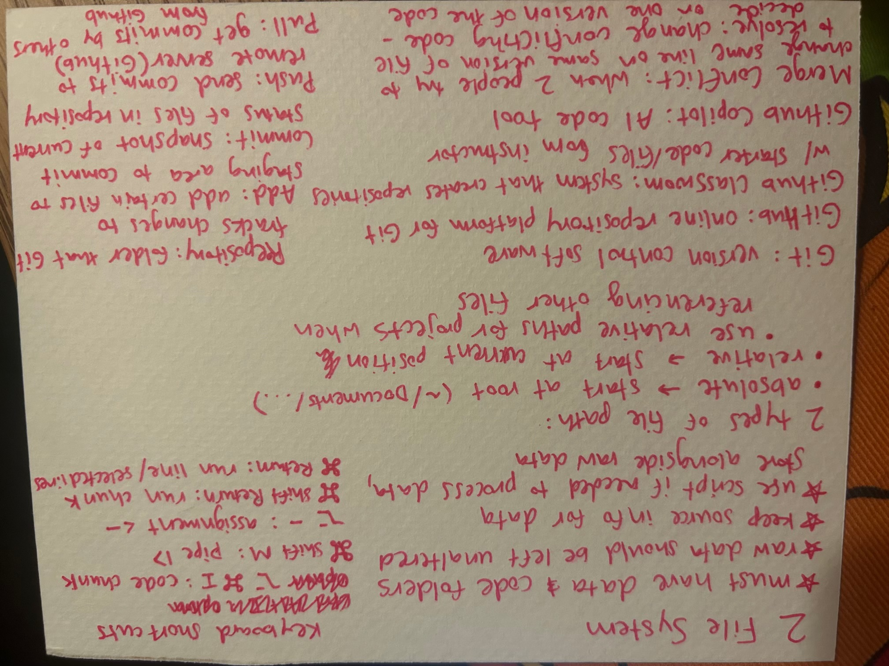

## Advanced Data Visualization
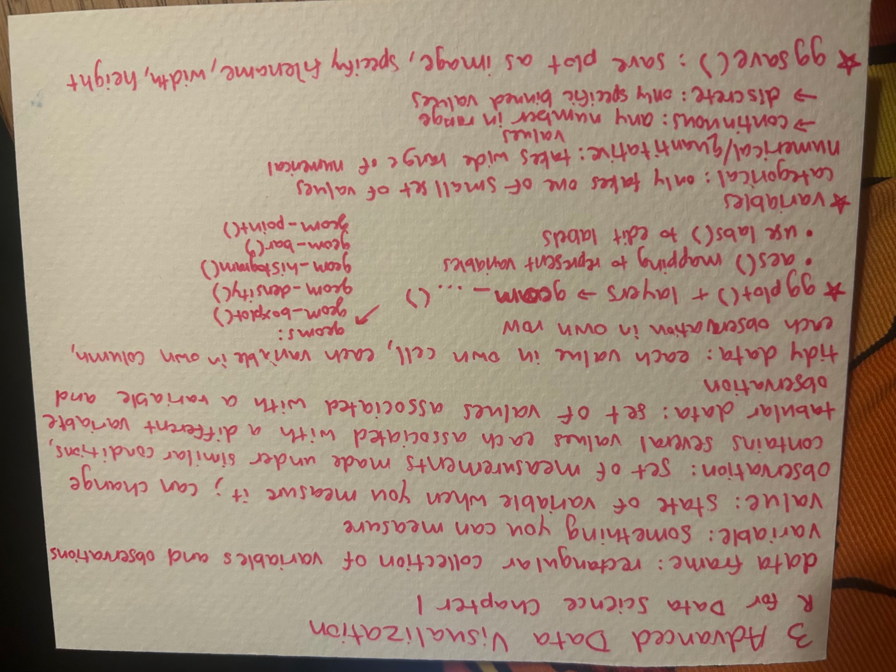

## Advanced Spatial Visualization
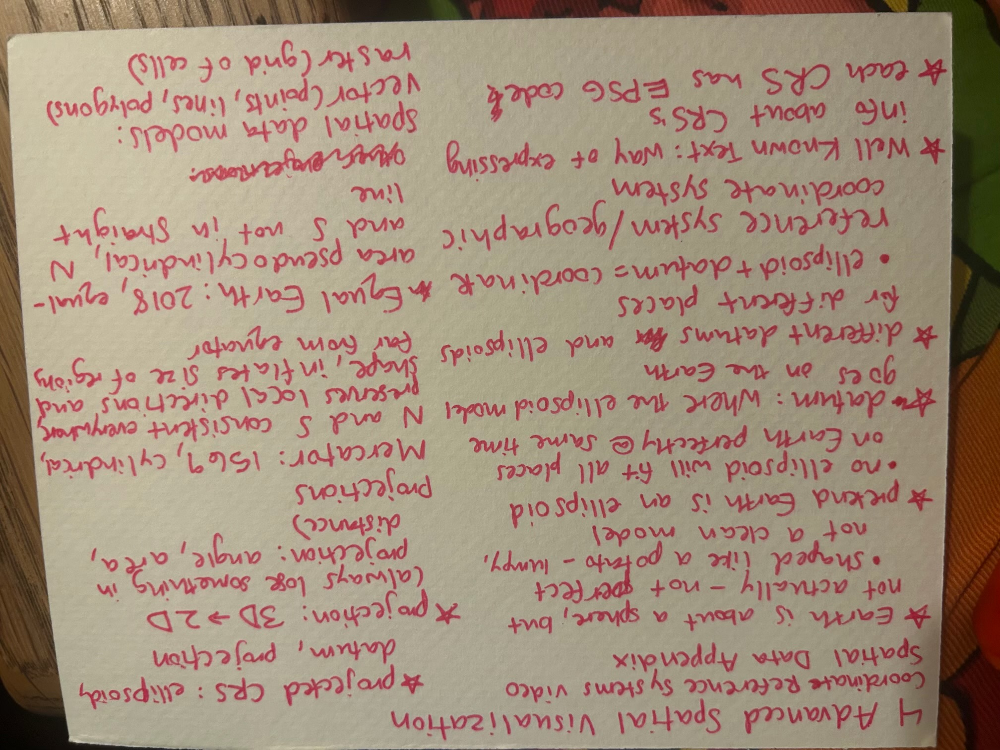

## Advanced Data Wrangling I
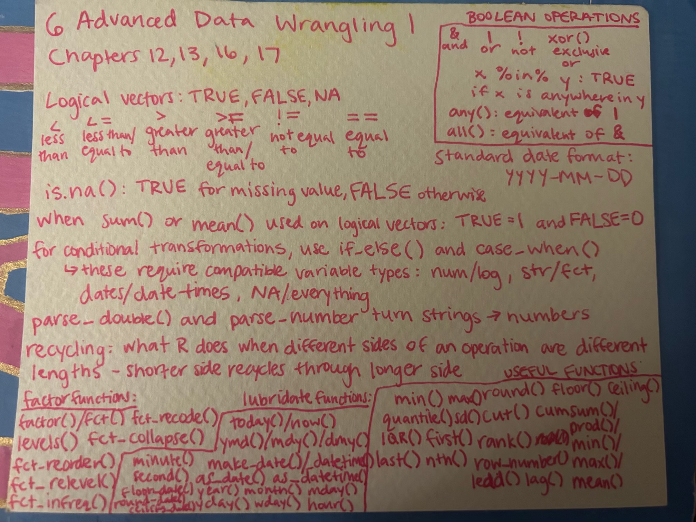

## Advanced Data Wrangling II
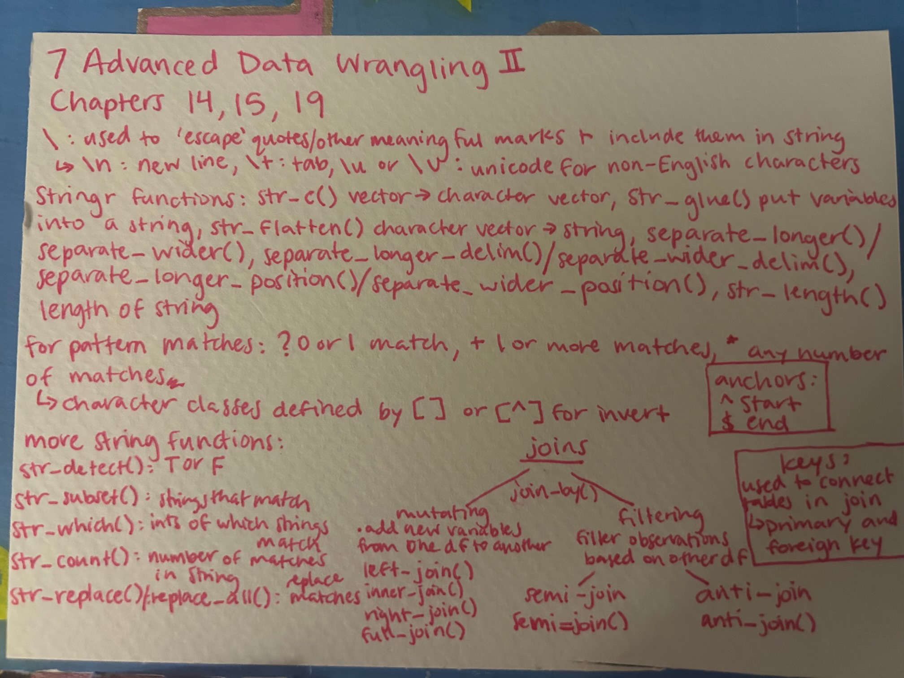

## Missing Data
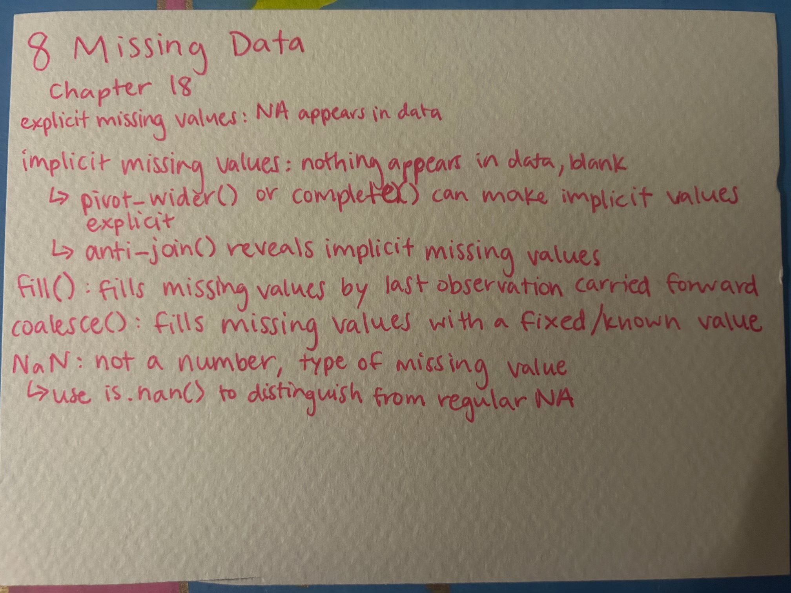

## Functions
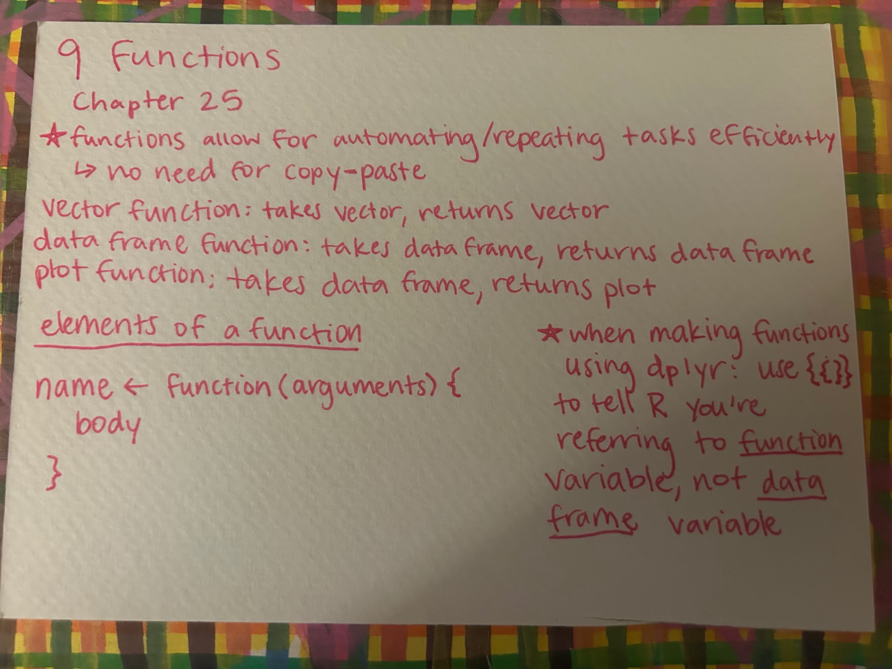

## Base R
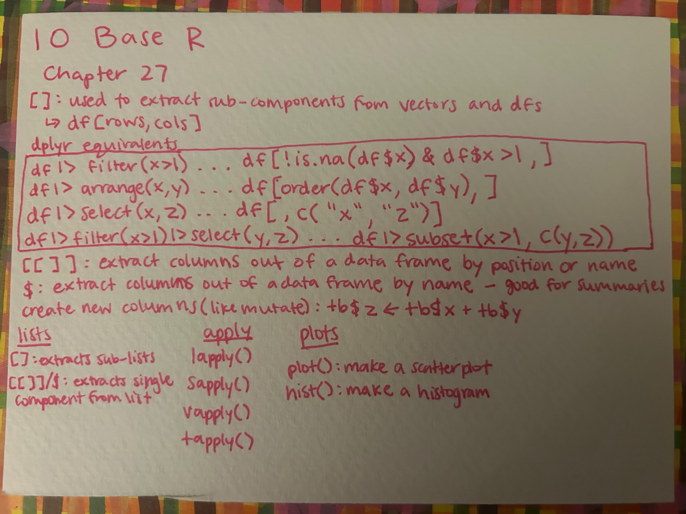

## Iteration I
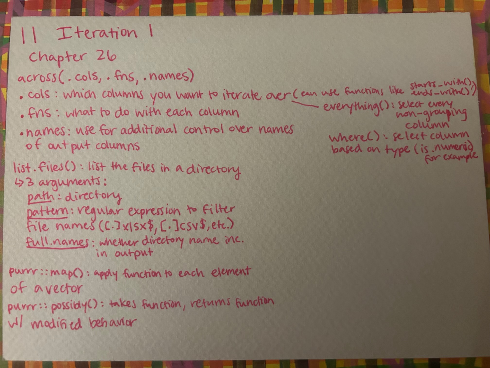

## Iteration II
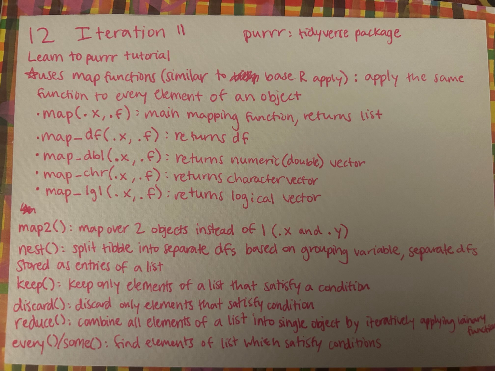

## APIs I
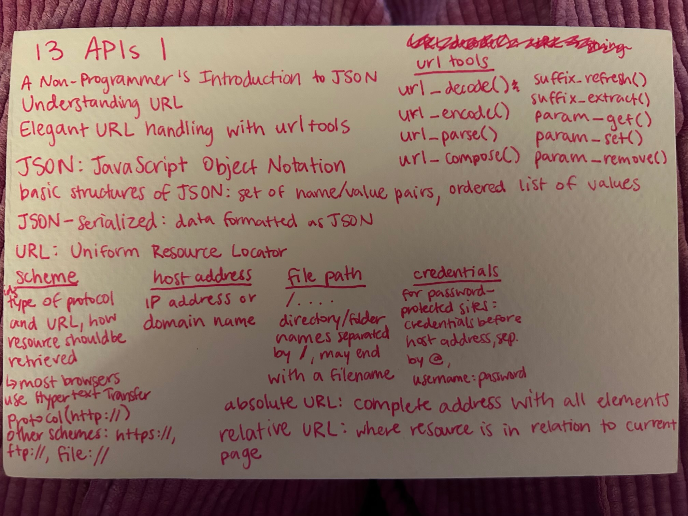

## APIs II
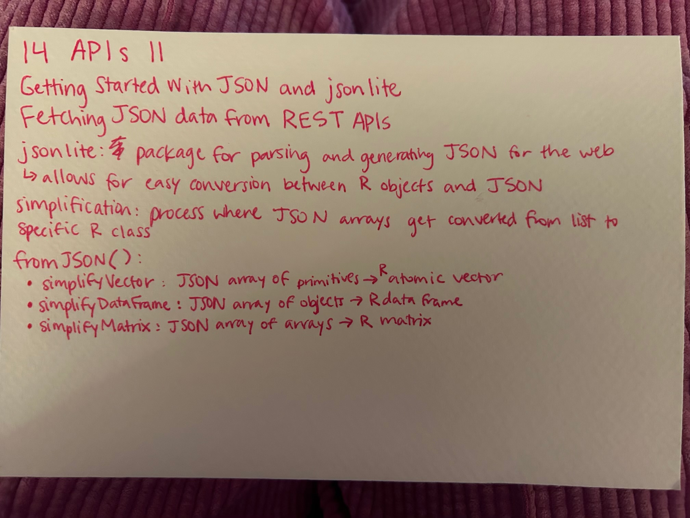

